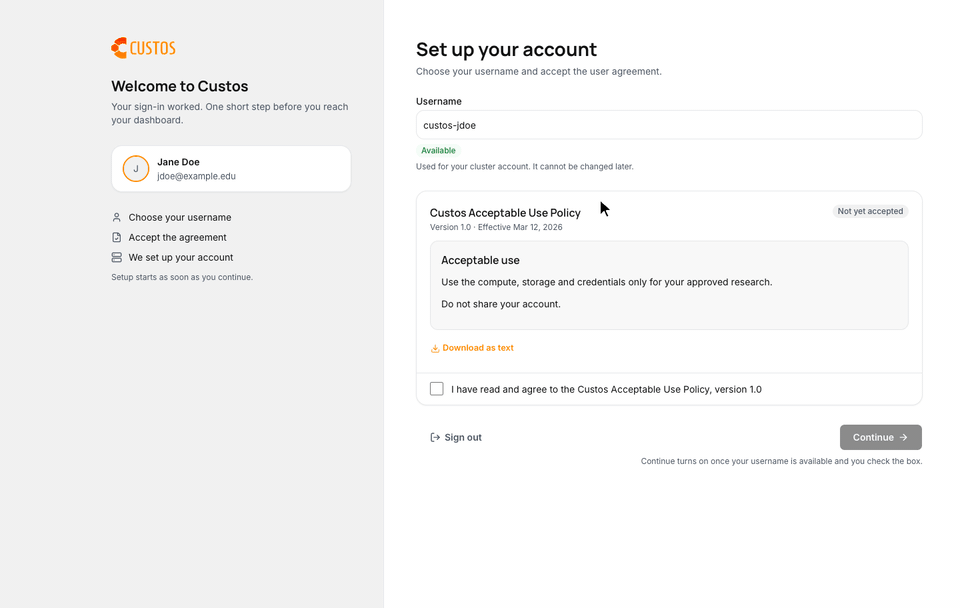
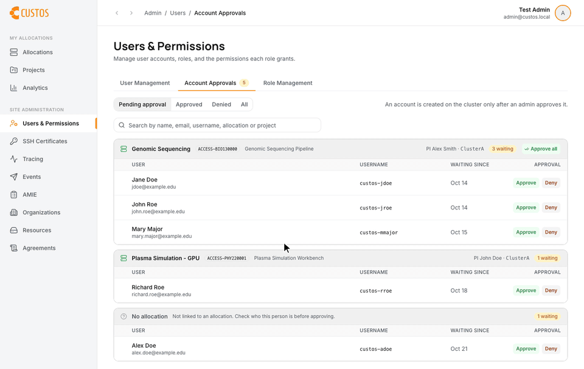
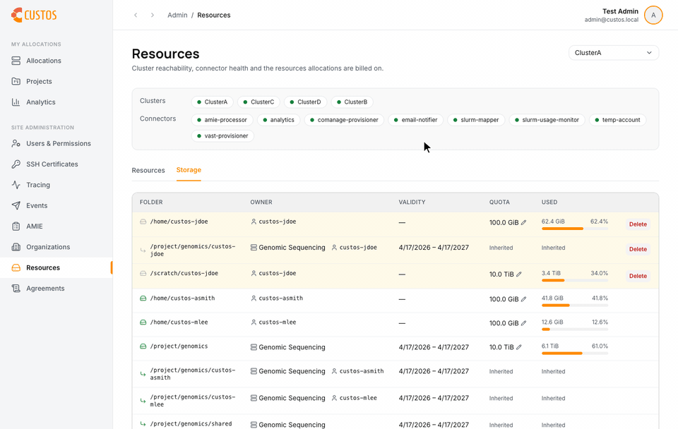
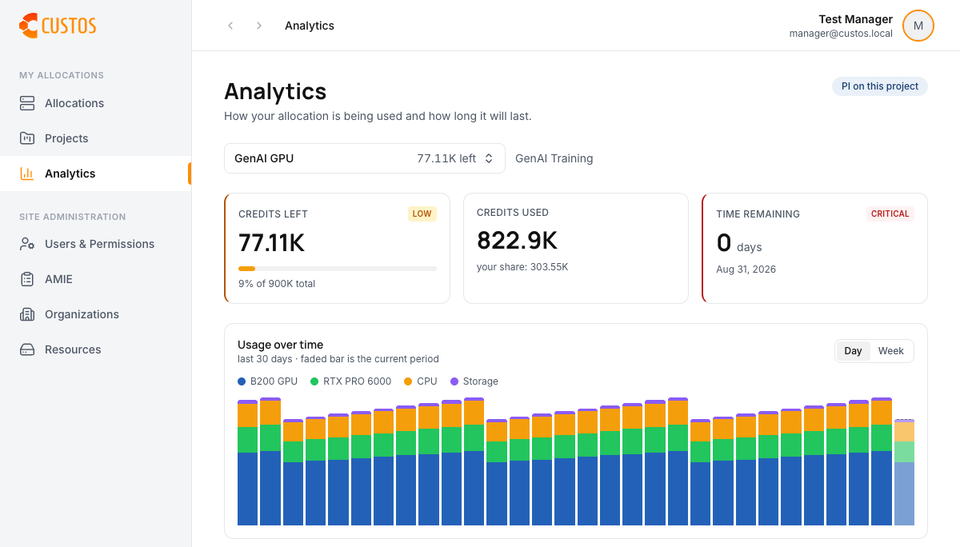

<!--
    Licensed to the Apache Software Foundation (ASF) under one
    or more contributor license agreements.  See the NOTICE file
    distributed with this work for additional information
    regarding copyright ownership.  The ASF licenses this file
    to you under the Apache License, Version 2.0 (the
    "License"); you may not use this file except in compliance
    with the License.  You may obtain a copy of the License at

      http://www.apache.org/licenses/LICENSE-2.0

    Unless required by applicable law or agreed to in writing,
    software distributed under the License is distributed on an
    "AS IS" BASIS, WITHOUT WARRANTIES OR CONDITIONS OF ANY
    KIND, either express or implied.  See the License for the
    specific language governing permissions and limitations
    under the License.
-->

# Apache Airavata Custos

Custos is account-lifecycle middleware for HPC resource providers.
It keeps one record per user, allocation, membership and cluster account.
Connectors apply each record change to the site's accounts, scheduler, storage and email.
Allocations arrive from ACCESS or from staff in the portal.
Users sign in through an OpenID Connect provider.

**[Project website](https://airavata.apache.org/custos/)**

## Who it helps

| Role | What changes |
|---|---|
| Account staff | One approval per account replaces seven manual tasks in five systems. Removal takes one account delete and one approval per marked top-level storage folder. |
| Researcher | Signs in, picks a username, and sees each setup step and the login command in the portal. |
| PI | Sees credits used and left, by resource and by member. With the `core:allocations:write` privilege, requests allocation changes in the portal. |
| Security staff | Each approval or denial has an audit row with the reviewer, user, cluster and username. |
| Gateway operator | Gets short-lived SSH certificates per user. Creates temporary accounts through the API. |

## Problems it addresses

| Problem at a site | What Custos does |
|---|---|
| One account lives in several systems, and they drift apart | Custos holds the single record, and connectors push each change out. Edit accounts in Custos, not in the account registry. Registry edits are not read back. |
| A downstream system is down when an account is approved | The change and its events are saved in one transaction, so an outage loses no event. Each delivery makes up to 10 attempts, backing off from 30 seconds to 1 hour. An admin can retry a failed one. |
| Scheduler access drifts from what allocations grant | A sweep runs every 5 minutes by default. It writes missing or changed associations and removes those of departed members. It removes associations only on scheduler accounts named after Custos allocations. |
| Two people get the same username or group | The database allows one `local_username` and one `posix_group` per cluster. |
| SSH keys to issue, rotate and revoke | Users log in with their institutional identity through the OAuth2 device flow. Gateways get short-lived SSH certificates. |
| A departed member keeps access | Ending a membership removes the scheduler association and the group membership. Deleting the cluster account removes it from the account registry. The next device-flow SSH login then fails. Key logins fail once the login node's SSSD cache expires, 90 minutes by default. |
| Storage is deleted by mistake | Removing an account or allocation only marks its storage directories for deletion. An admin approves each deletion, and the folders go to the storage trash. |

## Account lifecycle

With every connector enabled, an admin's approval is the only staff task for a new account.
A removal needs two staff steps: delete the cluster account through the API (`DELETE /compute-cluster-users/{id}`) or the allocation in the portal, then approve each marked top-level storage folder in the portal.
Folders under a top-level folder go with it.

| Step | Operation on the site's system | Done by |
|---|---|---|
| Allocation arrives | Apply the AMIE packet, create each member's pending cluster account, reply to ACCESS for the project. Account replies wait for approval | Allocation connector ([AMIE Processor](connectors/ACCESS/AMIE-Processor/README.md)), or staff entry in the portal |
| Sign-in | Researcher signs in over OIDC, picks a username, accepts the user agreement, before or after approval | Portal |
| Approval | Admin approves the cluster account, alone or per allocation | Portal |
| Accounts | Create the person, POSIX uid, gid and groups in the account registry | Accounts connector ([COmanage](connectors/COmanage/Identity-Provisioner)) |
| Scheduler | Create the scheduler account and one association per active member, with limits | Scheduler connector ([SLURM](connectors/SLURM/Association-Mapper)) |
| Storage | Create user and project directories, quotas and views | Storage connector ([VAST](connectors/Storage/VAST-Provisioner/README.md)) |
| Notice | Email on request, decision and account ready | Notification connector ([Email](connectors/Notification/Email/README.md)) |
| Removal | Remove associations and group membership. Mark storage directories for deletion, which an admin approves | Scheduler, accounts and storage connectors |

Removal, step by step:

Every connector is optional and enabled by a block in `config/custos.yaml`.
To support another system, [write a connector](docs/contributing/writing-a-connector.md).
[docs/architecture.md](docs/architecture.md) covers the core, the event bus and the connector contract.

## SSH sign-in

| Extension | What it does |
|---|---|
| [CILogon PAM module](extensions/CILogon-SSH-PAM/README.md) | `pam_oauth2_device` authenticates SSH logins with the OAuth2 device flow against the site's OIDC provider. The [node enrollment playbook](dev-ops/account-provisioning/README.md) keeps SSH key logins, and password logins for accounts with a local password, unless the site disables them. |
| [SSH Certificate Signer](extensions/SSH-Certificate-Signer/README.md) | An SSH CA for science gateways. Issues short-lived OpenSSH user certificates bound to the user's OIDC identity. |

## Portal

A researcher picks a username and accepts the agreement:

The setup steps finish once an admin approves the request.
Approval can come before or after the researcher signs in.
Admins approve requests grouped by allocation:

Admins approve each marked storage folder of a deleted account:

PIs track usage:

## Documentation

| Doc | Covers |
|---|---|
| [INSTALL.md](INSTALL.md) | Run Custos locally |
| [CONFIG.md](CONFIG.md) | Server configuration, with links to each connector's keys |
| [docs/architecture.md](docs/architecture.md) | How core and connectors work |
| [CONTRIBUTING.md](CONTRIBUTING.md) | Build, test and conventions |
| [docs/publications.md](docs/publications.md) | Papers |

## Questions or Need Help?

* Open a [GitHub issue](https://github.com/apache/airavata-custos/issues)
* Join the [Airavata dev mailing list](https://airavata.apache.org/mailing-list.html)

## Acknowledgment

This project is funded by the National Science Foundation (NSF).

We are grateful to [Trusted CI](https://www.trustedci.org/) for conducting the [First Principles Vulnerability Assessment (FPVA)](https://dl.acm.org/doi/10.1145/1866835.1866852) for this software and providing security architecture guidance and improvements.
