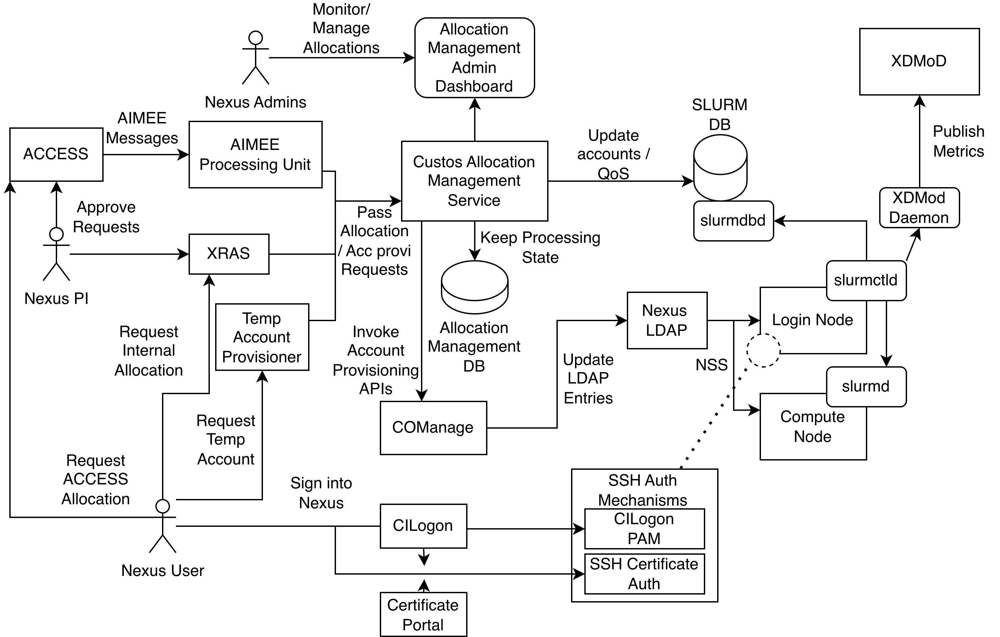

<!--
    Licensed to the Apache Software Foundation (ASF) under one
    or more contributor license agreements.  See the NOTICE file
    distributed with this work for additional information
    regarding copyright ownership.  The ASF licenses this file
    to you under the Apache License, Version 2.0 (the
    "License"); you may not use this file except in compliance
    with the License.  You may obtain a copy of the License at

      http://www.apache.org/licenses/LICENSE-2.0

    Unless required by applicable law or agreed to in writing,
    software distributed under the License is distributed on an
    "AS IS" BASIS, WITHOUT WARRANTIES OR CONDITIONS OF ANY
    KIND, either express or implied.  See the License for the
    specific language governing permissions and limitations
    under the License.
-->

# ACCESS Resource Provider Reference

A reference architecture for an ACCESS-CI resource provider that runs Custos. It covers where allocations come from,
what Custos does with them and how users sign in. Read it when you plan a Custos deployment for an ACCESS cluster.
The [glossary](glossary.md) defines terms such as AMIE and site code.

## Allocation sources

Typical ACCESS clusters can have 2 main allocation feeding sources:

1. **ACCESS Accounting Database (XACCT)**: ACCESS already has the proposal submission workflow. Once completed by the user and ACCESS admins, ACCESS sends resource allocation requests through AMIE protocols.

2. **Resource Provider Discretion**: A dedicated eXtensible Resource Allocation Service (XRAS) is deployed for registering proposals, review, and submission to allocation management at the final stage.

## Allocation management

The AMIE connector (`connectors/ACCESS/AMIE-Processor`) imports ACCESS allocations. It polls the AMIE API, applies
each packet to core users, projects and allocations, and replies to ACCESS. Core then publishes events for other
connectors. This reference uses these, each optional:

| Action | Connector |
|---|---|
| Give each approved cluster account a POSIX identity in COmanage | `connectors/COmanage/Identity-Provisioner` |
| Create or update SLURM accounts and associations | `connectors/SLURM/Association-Mapper` |
| Create account and project directories with quotas on VAST | `connectors/Storage/VAST-Provisioner` |

### Account provisioning

Provisioning requests are forwarded to CILogon Comanage to carry out the provisioning workflow. Comanage is responsible for populating preconfigured LDAP entries on the cluster's LDAP server, which tracks the cluster's Linux user accounts through NSS.

### SLURM updates

The Association-Mapper manages accounts, associations and TRES (trackable resource) limits through `slurmrestd`. Its configuration is in
[`connectors/SLURM/Association-Mapper/README.md`](../connectors/SLURM/Association-Mapper/README.md). The design
discussion is [GitHub issue #462](https://github.com/apache/airavata-custos/issues/462).

## Cluster sign-in

Custos ships two sign-in extensions. A site deploys either or both, alongside or instead of SSH keys or passwords.
This reference uses the [CILogon PAM module](../extensions/CILogon-SSH-PAM/README.md).

### CILogon PAM module (`extensions/CILogon-SSH-PAM`)

Users authenticate through the CILogon device authentication flow. Once authenticated, [PAM](../extensions/CILogon-SSH-PAM/README.md#how-it-works) validates the CILogon ID against LDAP to find the local account requested at the SSH prompt. If both match, the user is allowed to sign in.

### SSH certificates (`extensions/SSH-Certificate-Signer`)

An SSH certificate is a short-lived credential signed by a CA the cluster trusts. A gateway, such as a science
portal, sends the signer the user's OIDC token and SSH public key. The signer checks the token and returns a short-lived certificate for one principal.
The gateway then reaches the cluster on the user's behalf.
