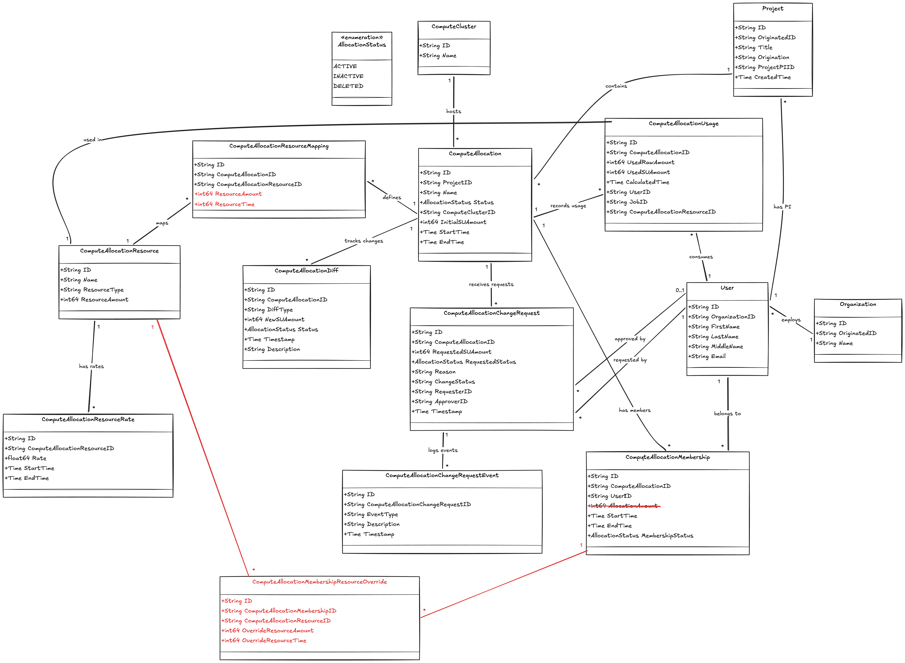

<!--
    Licensed to the Apache Software Foundation (ASF) under one
    or more contributor license agreements.  See the NOTICE file
    distributed with this work for additional information
    regarding copyright ownership.  The ASF licenses this file
    to you under the Apache License, Version 2.0 (the
    "License"); you may not use this file except in compliance
    with the License.  You may obtain a copy of the License at

      http://www.apache.org/licenses/LICENSE-2.0

    Unless required by applicable law or agreed to in writing,
    software distributed under the License is distributed on an
    "AS IS" BASIS, WITHOUT WARRANTIES OR CONDITIONS OF ANY
    KIND, either express or implied.  See the License for the
    specific language governing permissions and limitations
    under the License.
-->

# Compute Allocation Data Models

The data model behind compute allocation management: how projects receive cluster resources, how usage is charged and
how changes are recorded. Read it before you work on allocation endpoints or a connector that creates allocations or
records usage. The Go types are in `pkg/models/allocation.go` and `pkg/models/project.go`.

## The big picture

A project holds allocations. Each allocation is a budget on one cluster, in **Service Units (SU)**. A rate per resource
converts raw consumption, such as GPU hours, into SUs, so different resources draw on one budget. Users join an
allocation through a membership. Each finished job is recorded as usage. Each change to an allocation is recorded
as a diff.

## Users, organizations and projects

A **User** belongs to an **Organization** and is identified by name and email. A user's `status` is `PENDING`,
`ACTIVE`, `INACTIVE`, `SUSPENDED` or `MERGED`.

A **Project** groups one or more compute allocations (and, in the future, storage allocations) under a single umbrella. Projects carry an `Origination` field indicating the source system (ACCESS, NAIRR, XRAS, etc.) and a corresponding `OriginatedID` for cross-referencing. A project's `status` is `ACTIVE`, `INACTIVE` or `DELETED`.

Users relate to a project through roles:

| Role | Stored in | Gives |
|---|---|---|
| PI | `Project.ProjectPIID` | Ownership of and responsibility for the project |
| CO_PI, ALLOCATION_MANAGER | **ProjectMembership** | Governance of the project's allocations |
| MEMBER | An active **ComputeAllocationMembership** ([memberships](#memberships-and-per-user-limits)) | Use of that one allocation |

## Clusters and allocations

A **ComputeCluster** represents a physical or logical cluster where resources are provisioned. A user's login on it is a
**ComputeClusterUser**, which an administrator approves or denies. A site connector then provisions it.

A **ComputeAllocation** is the primary record linking a project to a cluster. It captures:

- The cluster where resources live (`ComputeClusterID`).
- An initial SU budget (`InitialSUAmount`) that covers all resource types within the allocation, exactly as the source granted it.
- A validity window (`StartTime` / `EndTime`).
- A lifecycle status (`ACTIVE`, `INACTIVE`, `DELETED`).
- The POSIX group the allocation's members share on the cluster (`PosixGroup`).

A single project can bundle multiple compute allocations — for example, one allocation on Cluster A with GPU resources and another on Cluster B with CPU resources.

## Resources and rates

**ComputeAllocationResource** represents a specific type of computing unit available within a cluster — for example, "GPU B200", "GPU RTX6000", or "CPU". Each resource records its type and the quantity allocated.

Resources are linked to allocations through **ComputeAllocationResourceMapping**, which is a many-to-many join: a single allocation can include multiple resource types, and the same resource definition can appear across allocations. Each mapping sets the amount
granted (`ResourceAmount`, such as a number of GPUs) and the wall-clock time (`ResourceTime`, in minutes).

**ComputeAllocationResourceRate** defines the SU conversion rate for a given resource over a time window. This is the mechanism that normalizes raw resource consumption into the common SU currency. Usage in SUs is
the raw amount times the rate. For example:

| Resource | Rate | Meaning |
|---|---|---|
| GPU H200 | 10.0 | 1 GPU-hour = 10 SU |
| CPU | 0.5 | 1 CPU-hour = 0.5 SU |
| GPU RTX6000 | 2.0 | 1 GPU-hour = 2 SU |

Rates are time-bounded (`StartTime` / `EndTime`), allowing rates to change over time without losing historical accuracy.

## Usage

**ComputeAllocationUsage** tracks resource consumption at the most granular level — per job, per user, per resource type. Each record captures both the raw amount consumed (e.g., 20 GPU-hours) and the equivalent SU cost (calculated using the effective rate at `CalculatedTime`). `CalculatedTime` is the job's end time, which picks the rate and the
allocation period. The API returns it as `last_updated`. Clients write usage with `POST /compute-allocation-usages`.
A connector such as SLURM Usage-Monitor writes it from finished jobs.

Aggregating all `ComputeAllocationUsage` records for a given allocation yields the total SU consumption, which can be compared against the allocation's SU budget to determine remaining balance.

## Memberships and per-user limits

**ComputeAllocationMembership** controls which users can submit jobs against an allocation. Each membership has its own validity window and status, independent of the parent allocation.

A member draws on the allocation's full resource grant by default. A **ComputeAllocationMembershipResourceOverride**
caps one member on one resource: `OverrideResourceAmount` replaces the mapping's amount and `OverrideResourceTime` its
time in minutes.

## Recording changes

A **ComputeAllocationDiff** records one change to an allocation: what changed (`DiffType`, the new SU amount, the
status), when, and a description. Direct allocation edits, such as attaching a resource, write no diff.

Diffs come from three paths:

1. **Change requests.** A user submits a **ComputeAllocationChangeRequest**, for example for more SUs or a status
   change. The request moves through `PENDING` to `APPROVED` or `REJECTED`, and each step is a
   **ComputeAllocationChangeRequestEvent**. When a request becomes `APPROVED`, core records a diff of type
   `CHANGE_REQUEST_APPROVED` in the same transaction.
2. **Automated workflows.** A connector such as AMIE writes diffs directly, for example when a project is created,
   inactivated or reactivated.
3. **Direct writes.** A client with `core:allocations:write` can create a diff with `POST /compute-allocation-diffs`.

## Status at three levels

Allocation state can be controlled from three independent levels:

| Level | Field | Effect |
|---|---|---|
| Project | `Project.Status` | Marks the whole project |
| Allocation | `ComputeAllocation.Status` | Deactivates one allocation without touching the others |
| Member | `ComputeAllocationMembership.MembershipStatus` | Revokes one user's access without touching the allocation or other members |

`PUT /projects/{id}/status` changes only the project row and publishes `project::update`. A workflow that freezes a
whole project sets each level itself. For `request_project_inactivate`, the AMIE connector marks the project, each
allocation and each membership `INACTIVE`, and records a diff per allocation.

## Model reference

| Model                                  | Purpose                                                        |
|----------------------------------------|----------------------------------------------------------------|
| `Organization`                         | Groups users under an institution.                             |
| `User`                                 | A person who can be a PI, a project role holder or an allocation member. |
| `Project`                              | Bundles allocations; linked to an origination system.          |
| `ProjectMembership`                    | A CO_PI or ALLOCATION_MANAGER role on a project.               |
| `ComputeCluster`                       | A cluster where resources are provisioned.                     |
| `ComputeClusterUser`                   | A user's account on a cluster, with its approval status.       |
| `ComputeAllocation`                    | SU budget for a project on a specific cluster.                 |
| `ComputeAllocationResource`            | A specific resource type (GPU model, CPU, etc.).               |
| `ComputeAllocationResourceMapping`     | Links resources to allocations (many-to-many).                 |
| `ComputeAllocationResourceRate`        | SU conversion rate for a resource, time-bounded.               |
| `ComputeAllocationDiff`                | A record of one change to an allocation.                       |
| `ComputeAllocationChangeRequest`       | User-submitted request to modify an allocation.                |
| `ComputeAllocationChangeRequestEvent`  | Lifecycle events on a change request.                          |
| `ComputeAllocationUsage`              | Per-job, per-user resource consumption record.                 |
| `ComputeAllocationMembership`          | User access to an allocation.                                  |
| `ComputeAllocationMembershipResourceOverride` | A per-member cap on one resource's amount and time.     |
