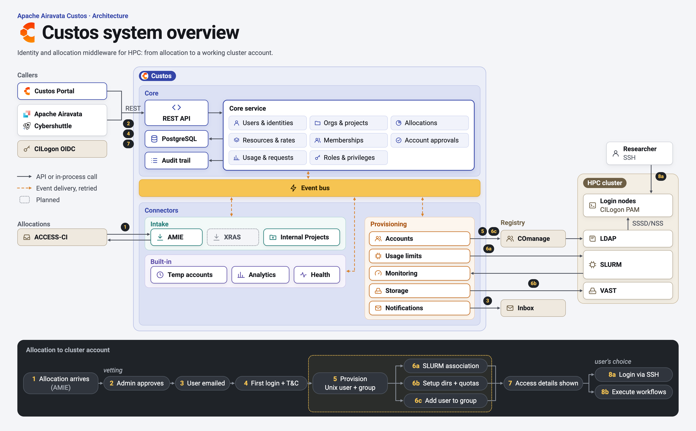

<!--
    Licensed to the Apache Software Foundation (ASF) under one
    or more contributor license agreements.  See the NOTICE file
    distributed with this work for additional information
    regarding copyright ownership.  The ASF licenses this file
    to you under the Apache License, Version 2.0 (the
    "License"); you may not use this file except in compliance
    with the License.  You may obtain a copy of the License at

      http://www.apache.org/licenses/LICENSE-2.0

    Unless required by applicable law or agreed to in writing,
    software distributed under the License is distributed on an
    "AS IS" BASIS, WITHOUT WARRANTIES OR CONDITIONS OF ANY
    KIND, either express or implied.  See the License for the
    specific language governing permissions and limitations
    under the License.
-->

# Architecture

How Custos is put together: layout, connector loading, requests, events and audit. Read it before you change core or
write a connector.

## The big picture

Only three parts of Custos are fixed:

| Part | What it is |
|---|---|
| Core records | Users, organizations, projects, allocations, memberships and cluster accounts, in PostgreSQL |
| State machine | The service layer in `pkg/service`. It is the only code that changes the records, for example by approving a cluster account or deactivating a membership. |
| Event bus | `pkg/events`. The service layer publishes each change as an event in the same transaction. The bus delivers it to each subscriber with retries. |

Everything that talks to another system is a connector: allocation intake from ACCESS, accounts in COmanage,
SLURM associations, storage on VAST, email. No connector is required. A site enables one with a block in
`config/custos.yaml`. Only `internal/connectors/loader.go` imports connector packages.

Portals and gateways read the core records through the REST API.



The bottom strip shows the steps from allocation to cluster account in one order. Admin approval and the user's
first sign-in can happen in either order.

## Repository layout

```
airavata-custos/
├── cmd/server/    # Server entry point
├── pkg/           # Shared contracts and domain models
├── internal/      # Server internals: HTTP handlers, stores, migrations, config
├── connectors/    # Adapters to external allocation, identity and storage systems
├── extensions/    # Opt-in services that run on or near HPC nodes
├── api/           # Generated OpenAPI spec for the core endpoints
├── config/        # Server configuration (custos.yaml)
├── web/           # Custos portal (Next.js)
└── dev-ops/       # Local Compose stack, Terraform, Ansible
```

| Directory | Contents | Examples |
|---|---|---|
| `cmd/server` | Opens the database, runs migrations, builds the service, loads connectors and serves HTTP | `main.go`, `bootstrap.go` |
| `pkg` | Contracts that connectors build on. `service.Service` is the domain API; `events.Bus` carries domain events | `pkg/models`, `pkg/service`, `pkg/events`, `pkg/identity` |
| `internal` | Code private to the server module | `internal/server` (handlers), `internal/store`, `internal/db/migrations`, `internal/connectors/loader.go` |
| `connectors` | Packages compiled into the server, one per external system | `ACCESS/AMIE-Processor`, `SLURM/Association-Mapper` |
| `extensions` | Separate processes a site deploys if it wants them | `CILogon-SSH-PAM`, `SSH-Certificate-Signer` |
| `api` | `core.openapi.yaml`, generated from handler annotations | [`api/README.md`](../api/README.md) |
| `config` | `custos.yaml`, with `${VAR}` interpolation for secrets | [`CONFIG.md`](../CONFIG.md) |
| `web` | The portal that calls the REST API | [`web/README.md`](../web/README.md) |
| `dev-ops` | Local dev stack and deployment automation | `compose/`, `terraform/`, `account-provisioning/`, `local-amie/` |

## Runtime topology

Custos runs as one Go binary. `cmd/server/main.go` does the following, in order:

1. Opens the database and applies the core migrations.
2. Builds the service layer, event bus and router.
3. Calls `connectors.LoadConnectorsFromConfig`.

Each enabled connector loads into the same process. It shares the database handle, event bus, router and
`*service.Service`.

### The `LoadConnector` contract

Each connector exposes `LoadConnector`. The `connectorLoaders` map in `internal/connectors/loader.go` enforces its
signature, and the [connector guide](contributing/writing-a-connector.md#runtime-model) lists its arguments. A
returned error stops startup. [CONFIG.md](../CONFIG.md#connectors) lists how each case is handled.

A connector mounts its routes under `/connectors/<name>/...` and subscribes to events on the shared bus. It may own
tables through its own embedded migrations. Its background goroutines join the server's `sync.WaitGroup`. On
shutdown the HTTP server gets 15 seconds to finish in-flight requests. The server then cancels `ctx` and waits up to
30 seconds for the WaitGroup.

### Connectors in the tree

| `type:` in config | Directory | Role |
|---|---|---|
| `amie-processor` | `connectors/ACCESS/AMIE-Processor` | Polls ACCESS-CI AMIE packets, applies them to core and sends replies |
| `comanage-identity-provisioner` | `connectors/COmanage/Identity-Provisioner` | Provisions approved cluster accounts and allocation groups in COmanage |
| `slurm-association-mapper` | `connectors/SLURM/Association-Mapper` | Mirrors allocation membership into SLURM accounts and associations |
| `slurm-usage-monitor` | `connectors/SLURM/Usage-Monitor` | Polls `slurmrestd` for finished jobs and records usage in core |
| `vast-storage-provisioner` | `connectors/Storage/VAST-Provisioner` | Creates directories, views and quotas on VAST |
| `email-notifier` | `connectors/Notification/Email` | Emails users about their cluster account requests |
| `analytics` | `connectors/Analytics` | Usage summaries and job lists for allocation participants |
| `temp-account` | `connectors/TempAccount` | Creates temporary accounts and assigns them allocations |

`connectors/SLURM/Rest-Client` is the shared `slurmrestd` client library, not a connector. `GET /connectors` lists
the configured connectors with their load status and requires `core:clusters:read`.

The SLURM, VAST and account-ready email steps wait until the COmanage connector marks the account provisioned
([connector guide](contributing/writing-a-connector.md#9-event-bus-if-you-publish-or-subscribe)).

### Extensions

Extensions are separate processes that `LoadConnectorsFromConfig` does not load. Each has its own OIDC
configuration.

| Extension | What it does | Relation to core |
|---|---|---|
| `CILogon-SSH-PAM` | A PAM module that lets `sshd` accept an OIDC device-flow login, CILogon at Custos sites | Does not call core |
| `SSH-Certificate-Signer` | Signs short-lived SSH certificates for OIDC-authenticated callers | Calls core `GET /me` to read the caller's privileges for its admin APIs |

### Membership readiness

A membership grants access while it and its allocation are `ACTIVE`, the scheduler has the allocation's account, and the member's account on the allocation's cluster is provisioned; core records it in `ready_at`.
Any write that changes it publishes `compute_allocation_membership::ready` or `compute_allocation_membership::deactivate` in the same transaction: membership writes, allocation status, account provisioning, account removal and user merges.
A membership create share-locks its user and allocation, and the resync after an allocation or account write locks them for update, so neither misses the other.
The settle pass also repairs drift from writes that bypass the service, publishing each change it makes.

### Connector requests

Core decides when a connector has work and publishes a request in the transaction of the write that causes it.
A connector handles one entity per request and reports completion through a core mark, which publishes the next event.
A request nobody subscribes to is not awaited: core stamps its mark itself.
Every 5 minutes core settles requests against current subscriptions: it stamps those whose connector was disabled
and drops pending deliveries no subscription holds. A request whose latest delivery ran out of retries an hour ago
is sent again while its entity still applies. Notifications are not resent.

The scheduler and storage connectors act on accounts the identity step provisioned. Any combination of the three
is valid: with no identity connector, core marks approved accounts provisioned, and the cluster's accounts must
exist by other means.

| Request | Published when | Done |
|---|---|---|
| `compute_cluster_user::identity_request` | an account is approved; its user onboards | `MarkComputeClusterUserProvisioned` |
| `compute_allocation::group_request` | an allocation or membership is written; an account is provisioned, deleted or merged | `compute_allocation::group_provision` |
| `compute_allocation::scheduler_request` | an allocation is created | `MarkComputeAllocationSchedulerProvisioned` readies its members |
| `compute_cluster_user::storage_request` | an account is provisioned | `MarkComputeClusterUserStorageProvisioned`, then `compute_cluster_user::ready` |
| `compute_allocation_membership::storage_request` | a member is ready and its allocation group is provisioned | the delivery succeeds |

## Identity and authentication

Inbound authentication is an OIDC bearer JWT. `pkg/identity/verifier.go` checks its signature, `iss` and `aud`.
`iss` and `aud` must match `core.auth.oidc.{issuer,audience}`. The resolved caller is cached for `core.auth.cache_ttl`
([CONFIG.md](../CONFIG.md#core-keys)).

Routes register through one of five router methods:

| Method | Who gets through | Example |
|---|---|---|
| `Public(pattern, h)` | Anyone; the token is not checked | `GET /healthz` |
| `RequireAuthWithoutUserConsent(pattern, h)` | A verified caller, before onboarding or accepting the user agreement | `GET /me`, `POST /me/onboarding` |
| `RequireAuth(pattern, h)` | A verified caller who has onboarded and accepted the current agreement | `GET /projects`, `GET /compute-allocations` |
| `RequireScoped(pattern, authorize, h)` | A verified caller whom `authorize` admits for that resource | `GET /compute-allocations/{id}` |
| `RequirePrivilege(pattern, key, h)` | A verified caller who holds `key` | `POST /compute-clusters` |

`GET /projects` and `GET /compute-allocations` return everything to a caller with the matching read privilege and
only the caller's own records otherwise. `RequireScoped` routes admit the read privilege or a participant in that
project or allocation, and return `404` to anyone else.

The middleware answers authentication failures with `{"code": ..., "message": ...}`:

| Status | `code` | Cause |
|---|---|---|
| `401` | `missing_bearer` | No `Authorization: Bearer` header |
| `401` | `invalid_token` | Signature, issuer, audience or expiry check failed |
| `401` | `identity_not_linked` | The token's identity matches no Custos user |
| `403` | `user_disabled` | The user is disabled |
| `403` | `onboarding_required` | First sign-in; the user has not onboarded |
| `403` | `consent_required` | A newer user agreement waits for acceptance |
| `403` | `insufficient_privilege` | The route's privilege is missing |
| `503` | `auth_lookup_failed` | Caller resolution failed |

### Privileges

Privilege keys have the shape `<owner>:<scope>:<action>` and live in a runtime registry. Core keys are declared in
`pkg/models/privilege.go`. Each connector registers its own keys with `models.Register(...)` at startup, for
example in `connectors/ACCESS/AMIE-Processor/server/privileges.go`. A user holds a privilege by a direct grant or
through a role (`roles`, `role_privileges`, `user_roles`). `coreService.EffectivePrivileges` returns the union.
[`privileges.md`](privileges.md) lists the keys and the routes each one gates.

## Event bus

`pkg/events.Bus` stores events in three core tables: `event_subscriptions`, `events` and `event_deliveries`. There
is no external broker. A subscriber is a connector, named by its `Type` constant. Subscriptions are saved, so an
event published while a connector is not loaded gets a delivery row and waits for it.

| Setting | Value |
|---|---|
| Poll interval for due deliveries | 10 seconds |
| Handler timeout | 2 minutes |
| Retry backoff | 30 seconds, doubling up to 1 hour |
| Attempts | 10 |
| Fail without retry | The handler's error wraps `events.ErrPermanent` |

Handlers must be safe to run more than once for the same event. The bus worker writes an `audit_events` row for each
delivery attempt, under the event's trace. Four endpoints expose the bus:

| Endpoint | Use |
|---|---|
| `GET /events/deliveries` | List deliveries |
| `POST /events/deliveries/{id}/retry` | Retry a failed delivery |
| `GET /events/subscriptions` | Show which subscribers are loaded |
| `GET /events/graph` | Show which events lead to which ([how it is built](../internal/server/eventgraph/README.md)) |

## Worked example: approving a cluster account

This example follows one request through identity, the service layer and the event bus.

1. The portal sends `POST /compute-cluster-users/{id}/approve` with a bearer JWT.
2. `identity.Middleware` verifies the token against the configured OIDC issuer. It resolves the caller from
   `user_identities` by the token's `sub` claim and puts the caller and their privilege set on the request context.
3. The router dispatches the request. `RequirePrivilege` checks for `core:clusters:write` and returns `403` when it
   is absent.
4. The handler calls `coreService.ApproveComputeClusterUser`. Inside one transaction the service records the
   review, writes an `audit_events` row and publishes `compute_cluster_user::approve` and
   `compute_cluster_user::identity_request`. The audit row and the events carry the request's `trace_id` and `span_id`.
5. The bus stores the event with one delivery row per subscriber, in that same transaction. The change, the audit
   row and the event commit or roll back together.
6. The handler returns the response.
7. The bus worker delivers each row to its subscriber. At a site that runs COmanage, for example, its connector
   provisions the account on the identity request and marks it provisioned. Each attempt writes an audit row under the same trace.
   A failed delivery is retried with backoff.

An invalid token returns `401` before any handler runs. A missing privilege returns `403` before the service is
called. A service error rolls the transaction back, so no audit row and no event are written.

Reviews, privilege and role changes, user agreements, onboarding and identity linking write their own audit row.
Plain create, update and delete calls such as `CreateUser` only publish an event.

## Audit conventions

All audit rows live in the core `audit_events` table. Core, connectors and extensions write the same columns:

- `id`, `event_type`, `event_time`, `entity_type`, `entity_id`, `details` and `source`.
- The OpenTelemetry trace columns `trace_id`, `span_id` and `parent_span_id`.

The trace endpoints `/audit/traces`, `/audit/traces/{trace_id}`, `/audit/events` and `/audit/sources` read this one
table.

A connector keeps its own references to an audit row, such as AMIE's `packet_id` and `event_id`, in a
`<connector>_audit_extras` table. Its primary key `audit_event_id` is a foreign key to `audit_events(id)` with
`ON DELETE CASCADE`. Only AMIE has one.

Connectors do not add columns to the core table. The trace view does not read extras tables. For the schema, store
and same-transaction write, see
[the connector guide](contributing/writing-a-connector.md#11-audit-rows-and-audit_extras-if-you-have-your-own-references).

## Where to look next

| Topic | Document |
|---|---|
| Writing a connector | [`contributing/writing-a-connector.md`](contributing/writing-a-connector.md) |
| Privilege keys and the routes they gate | [`privileges.md`](privileges.md) |
| Allocation domain model | [`Allocation-Data-Models.md`](Allocation-Data-Models.md) |
| REST API | [`API-Docs.md`](API-Docs.md) |
| ACCESS-CI resource provider setup | [`ACCESS-HPC-Reference.md`](ACCESS-HPC-Reference.md) |
| Domain terms | [`glossary.md`](glossary.md) |
